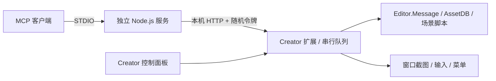

# CocosCreatorMCP

面向 **Cocos Creator 3.8.8** 的源码可见编辑器控制工具，当前为 **0.8.0 开发预览版**。支持 Codex 与标准 MCP STDIO 客户端，带 Creator 原生控制面板、批量操作、脚本/引用/按钮、预制体、资源依赖与替换、原生动画、Spine、场景视图/参考图、Widget/Layout/ScrollView 自适应、字体/UI 诊断和 Web 构建产物运行验证。

**许可：个人学习和非商业使用免费；商业游戏、公司/组织或客户项目、收费服务，以及原版/修改版再分发，均须事先取得书面授权。** 商业授权联系：[17268680050@163.com](mailto:17268680050@163.com)。详见 [LICENSE](LICENSE) 与 [许可说明](docs/LICENSING.md)。本项目不使用 MIT/Apache/GPL，也不属于 OSI 定义的开源许可。

目前可以完成已验收的常见 2D 场景/UI、脚本事件、预制体、动画和 Web 交付流程，能修改公开参数并回读、保存重开和检查实际预览。它仍不是 100% 人工编辑器替代品；复杂 UI、动画图、原生 SDK 平台等仍有缺口，也没有 Pro 同任务实测领先结论。0.8 的布局配置已做原生回读，但新面板完整输入回归、缺失组件配置失败清理与跨分辨率视觉验收仍未完成，适合以 Pre-release 收集反馈。

无需账号、激活码或桥接厂商云服务。桥接不调用模型 API、不采集遥测；模型服务由用户自己的 AI 客户端提供。

**第一次使用：** [环境安装与客户端连接](docs/INSTALLATION.md) · **维护者：** [GitHub 建仓与打包发布](docs/GITHUB-RELEASE.md) · [已验证范围](docs/COVERAGE.md) · [路线图](docs/ROADMAP.md)

## 开始使用

需要 Node.js 22+ 和 Creator 3.8.8。下载或克隆本仓库，在仓库目录运行：

```sh
npm ci
node scripts/cli.mjs install --project "/absolute/path/to/YourGame"
```

1. 在 Creator 中打开该项目，在扩展管理器中确认 `cocos-codex-bridge` 已启用。
2. 打开 **扩展 → Cocos MCP → 控制台**。
3. 在「连接与设置」复制配置，加入客户端的 MCP 设置，重启该连接。
4. 让 AI 检查连接、读取场景；或在「UI 模板」中先预检查再生成。

安装器会准备项目级 `.codex/config.toml`。已有配置会保留，另写示例文件供合并；项目级配置需被客户端信任。控制台复制配置不会自动改写客户端全局设置。

当前仓库尚未发布到 npm，因此不要把包名当成已经可用的 `npx` 安装入口。已安装的本机 `cocos_creator` 服务继续使用同一服务脚本，重启连接后会采用新的精简工具模式。

首条指令示例：

> 使用 cocos_status 核对项目和 Creator 版本。通过 cocos_catalog 查找场景读取与 UI 构建操作，查询所需参数。先对 menu 模板 dryRun，再生成到现有 Canvas，读取层级并截图检查，确认后保存。

## 控制面板

- **概览**：项目、版本、连接、请求流量与失败记录。
- **能力目录**：搜索真实操作，点击展开准确参数。
- **UI 模板**：menu、dialog、hud，支持预检查和原生生成，不自动保存。
- **文字与布局**：Label/RichText、字体/实际字号、UI 矩形、有限诊断和问题节点定位，配置支持预检查。
- **UI 适配**：语义配置 Widget、Layout、ScrollView、Mask、SafeArea 和 BlockInputEvents；缺失组件可补齐，枚举/节点引用按 Creator 检查器转换并回读。
- **场景视图**：Gizmo/Pivot/坐标系、2D/3D、网格、图标 Gizmo、相机聚焦/对齐/重置，以及外部参考图叠加和变换。
- **预制体**：选中节点检查、预检查创建、验证资源、原生编辑、备份保存与返回。
- **资源与构建**：依赖/反向引用图、动画曲线、Spine 兼容性与内容、Web 构建/进度/日志/产物/运行。
- **操作记录**：请求 ID、排队/执行/完成/失败状态。
- **连接与设置**：复制 Codex TOML 或通用 STDIO JSON、暂停后续编辑、关闭高级脚本/消息入口。

桥接流量不是模型 Token 计费。暂停不会取消正在运行的操作，也不回滚已完成修改。

## 给 AI 的四个入口

| 工具 | 用途 |
| --- | --- |
| `cocos_status` | 检查项目与编辑器连接 |
| `cocos_catalog` | 按需发现操作及参数 |
| `cocos_execute` | 顺序批量执行，跨步骤引用结果，失败停止 |
| `cocos_observe` | 只读查询、字段投影、截图图像 |

当前目录包含 90 项操作，`cocos_catalog` 可用 `ops` 一次获取最多 12 项 schema。UI 模板只会生成到真实项目层级；缺少 Canvas 时自动创建 Canvas 和 UI 相机，完成后选中、切换 2D 并定位。数量不代表全编辑器覆盖率。批量参数示例见 [精简工具说明](docs/COMPACT-TOOLS.md)。

精简模式减少常驻工具说明；默认摘要、字段投影和结果引用减少重复传输。实测旧 30 工具清单为 18,508 字节，当前 4 工具清单为 3,255 字节，减少 **82.4%**。同一组 4 项读取任务在实际 MCP 测试中，从 4 次执行调用降为 1 次，任务返回 JSON 从 3,566 降为 672 字节；首次 schema 发现另需 1 次调用，报告单独计入。以上是调用与 UTF-8 JSON 数据，不是模型 Token/费用或 Pro 性能比较。运行 `npm run benchmark:workflow` 可复测。

如需旧工具名称，启动时添加 `--tools legacy`：

```sh
node scripts/cli.mjs serve --project "/absolute/path/to/YourGame" --tools legacy
```

旧工作流见 [WORKFLOWS](docs/WORKFLOWS.md)。

## 当前可用范围

基础场景/节点/组件编辑、撤销重做、AssetDB 文本写入、日志与消息发现、通用脚本，以及窗口截图/输入/菜单已有本机验证。0.2 新增批量计划、UI JSON 树与三个模板、结构快照/diff、两项结构校验和小型工作流知识库。

0.3 新增节点 UUID/路径/名称解析、简洁组件属性、类型与引用校验、脚本等待/挂载、按钮事件、预览窗口/日志和真实点击回归。提供主菜单、设置和背包的独立可交互示例，脚本/引用/事件保存重开后仍保留。用法与边界见 [开发工作流](docs/DEVELOPMENT-WORKFLOWS.md)。

0.4 新增 11 项预制体操作：创建、实例化、应用/还原/解除链接、原生编辑/保存/返回、引用验证和备份恢复。共享资源写入检查 SHA256 版本并保存项目本地备份；原生创建会替换源子树 UUID，工具返回新节点。自定义脚本、内部引用、数组、贴图、按钮事件和嵌套链接已有实际保存重开检查。用法与限制见 [预制体工作流](docs/PREFAB-WORKFLOWS.md)。

0.5 新增 26 项操作：有界依赖/反向引用图、原生导入/复制/移动/重导入、引用替换计划/应用/备份恢复；8 类动画轨道与事件、Spine 3.8 兼容检查/配置/运行控制；Web Desktop/Mobile 的提交、终态、日志、产物检查和实际启动。已在独立样例中验证保存重开、动画业务事件及 Spine 事件，并检查两类实际构建产物。用法与边界见 [资源、动画与构建](docs/RESOURCE-ANIMATION-BUILD.md)。

0.6 新增五项字体与 UI 操作：系统/TTF/位图字体检查和绑定、Label/RichText 配置、实际缩小字号、UI 四角/AABB、Canvas/Camera/layer/越界/位图缺字等有限诊断；面板有预检查/应用和问题节点选择。保存重开、实际预览、变换后测量和真实面板输入已验证。同一九节点样例的 compact 测量 JSON 比 full 减少 65.9%；不是模型 Token 或 Pro 基准。用法与边界见 [字体与 UI](docs/TYPOGRAPHY-UI.md)。

0.8 新增 `ui.layout` 紧凑操作：用 Widget 锚点/边距、Layout 横向/纵向/网格、ScrollView 内容与方向、Mask、SafeArea 和 BlockInputEvents 的语义字段完成配置；枚举值按 Creator 3.8.8 实际检查器转换，节点引用先解析，写入后回读，dryRun 不写入，缺失组件可自动补齐。真实测试覆盖自适应布局、滚动内容引用、预检查和清理。用法与边界见 [UI 自适应布局](docs/UI-LAYOUT.md)。

复杂预制体变体/多层覆盖、模型动画/动画图、Spine 二进制格式矩阵、完整国际化/跨分辨率视觉回归、参考图像素差异、通用业务断言、原生平台构建与发行向导仍待完善；原生系统对话框不在现有 Electron 窗口输入范围内。不能将通用脚本入口等同于这些工作流已经完成。

详细状态见 [覆盖记录](docs/COVERAGE.md)，后续能力与验收条件见 [路线图](docs/ROADMAP.md)。参考第三方 Pro 的公开功能范围，使用独立实现，不复制受限源码或二进制；完整能力分析、当前差距、24 项需求和 30 个验收任务见 [Pro 分析与超越目标](docs/PRO-CAPABILITY-ANALYSIS.md)。

## 架构



`src/operations.mjs` 是参数定义来源，生成 `extension/operations.json`。MCP 与编辑器端共用批量预检查逻辑，UI 模板走原生消息。扩展为普通 CommonJS，无需编译或在编辑器内安装 SDK；MCP 使用官方 SDK 与 Zod。

## 开发与验证

```sh
npm test
npm run benchmark
node scripts/cli.mjs doctor --project "/absolute/path/to/YourGame"
npm run demo:interactive
npm run test:live:runtime
npm run test:live:development
npm run test:live:prefab
npm run demo:workflow
npm run test:live:resources
npm run test:live:animation
npm run test:live:workflow
npm run benchmark:workflow
npm run demo:typography
npm run test:live:typography
npm run test:live:typography:panel
npm run release:local
npm run release:verify
```

修改操作 schema 后运行 `npm run generate`。新增全新安装/重复安装配置保护回归，当前共 51 项自动测试；包括多文件写失败、并发修改保护、备份篡改、缓存失效竞态、构建服务边界、字体/UI 规则和布局语义。实际资源、动画、Spine、文字/UI、布局与两类 Web 产物验证见 [覆盖记录](docs/COVERAGE.md)。示例生成不会覆盖已有场景；首次使用先保存当前场景。跨平台 CI 配置已经提供，其他系统的编辑器集成尚未验证。

真实编辑器检查只针对独立、可丢弃的 `test-project`，会修改和保存场景：

```sh
node scripts/create-test-project.mjs --creator "/path/to/Creator/3.8.8"
node scripts/install.mjs
# 在 Creator 中打开 test-project，等待资源与场景就绪
npm run test:live
npm run test:live:v2
npm run test:live:ui
```

测试工程、连接令牌、安装路径、截图与报告排除在版本控制外。贡献流程见 [CONTRIBUTING](CONTRIBUTING.md)，GitHub 发布、打包和用户安装见 [GitHub 发布与安装指南](docs/GITHUB-RELEASE.md)。

## 执行约定

- 仅监听 127.0.0.1，使用每实例随机端口与令牌，拒绝浏览器 Origin。连接文件存于项目 `temp/cocos-mcp/connection.json`，客户端核对项目路径，每次重新读取连接信息。
- 高级脚本/消息入口有完整编辑器进程权限，不是沙箱；可从面板关闭。原生操作、批量调用都会检查控制开关。
- 批量不是事务，失败前的编辑仍保留。超时先用请求 ID 查询 `operation.status`，禁止盲目重放写操作。
- UI 构建失败会尝试清理其新建子树，并报告结果；不代表所有操作可回滚。场景快照是有界结构比较，不是完整备份。
- 输入和菜单返回只说明已分发，必须读取状态或截图确认；窗口最小化时拒绝截图。

## 使用许可

采用 **CocosCreatorMCP Personal Non-Commercial License 1.0**。个人免费许可允许学习、非商业使用和本地修改；商用、组织用途、转售、托管及再分发须另行书面授权。GitHub 平台条款要求的查看和 Fork 权利不受排除，但不授予商业用途或更广泛的再分发许可。

使用工具不改变你独立创作的游戏、资源与代码的归属；使用本工具开发商业项目仍需商业授权。Creator、引擎和第三方依赖按各自条款使用。申请方式及场景示例见 [许可说明](docs/LICENSING.md)，贡献规则见 [CONTRIBUTING](CONTRIBUTING.md)。
